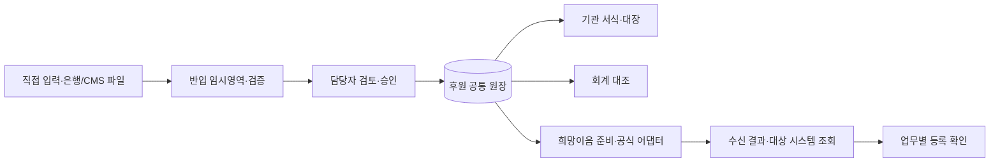

# 범용 복지기관 후원금·후원품 관리 및 희망이음 연계 시스템

개발 인수인계 명세서 · OW-DMS · v1.1 · 조사·통합 기준 2026-10-29(KST)

대상: Claude Code 개발자, 기관 후원담당자, 회계담당자, 승인권자, 개인정보 보호책임자

## 0. 이 문서로 시작하는 방법

이 파일을 새 개발 저장소의 `docs/CLAUDE_CODE_HANDOFF.md`로 복사하고, 20절의 착수 프롬프트를 Claude Code에 전달하십시오. 본 문서는 **개발 명세와 공개자료 조사 결과**입니다. 실행되는 프로그램, 설치된 개발환경, 확정된 희망이음 연계 인증을 제공하는 산출물은 아닙니다.

v1.1은 사용자가 추가 제공한 「통합 후원관리 시스템 고도화 기획안」과 초기 통합 시스템 기획안을 통합했습니다. 기능 요구는 본문 및 22절에 연결하고, 두 원문은 `sources/사용자제공_고도화기획안_원문.txt`, `sources/사용자제공_초기기획안_원문.txt`로 그대로 보존했습니다. Claude Code는 **본 문서의 통합 명세를 구현 기준으로 사용**하고 원문은 배경자료로 참조하십시오. 원문 속 외부 기능·법규·이미지 설명은 확인된 사실로 일괄 승격하지 않습니다.

### 핵심 결정

1. 후원금품의 업무 사실을 한 번 입력하고, 승인된 동일 원장에서 서식·통계·대조자료·연계자료를 파생합니다. 은행내역 수집, 후원자 확인, 승인, 공식 시스템 결과 확인은 각각 별도 절차입니다.
2. **희망이음의 개별 후원금·후원품 등록 API나 공식 일괄업로드 원본은 이번 조사에서 확보하지 못했습니다.** 초기에는 공통 원장과 내부 검토용 Excel을 구현합니다. 공식 파일 업로드와 직접 전송은 규격 확보 후 활성화합니다.
3. 표준연계모듈의 존재는 온라인 보고 연계 근거입니다. 이를 곧바로 후원금품 개별 거래 CRUD API라고 해석하지 않습니다. [S02, S03]
4. 기관별 분기 코드를 늘리지 않고 기관 프로필, 회계귀속, 코드표, 양식, 결재선, 적용 규정의 버전으로 차이를 관리합니다.
5. 실운영 회계의 최종 원장은 기관이 지정한 기존 회계시스템입니다. MVP는 후원 보조원장·회계 대조·전표 작성자료를 제공합니다. 전체 예산회계 ERP 교체는 범위 밖입니다.
6. 연무사회복지관의 실제 내부 서식·인수인계서·계약·계좌정보는 미확보입니다. 연무 전용 설정은 `검증 대기`이며 공통 예시를 기관 확정 절차로 표현하지 않습니다.
7. 개인정보와 실제 증빙은 Claude Code·공개 저장소·외부 AI에 기본적으로 전달하지 않습니다. 개발은 합성자료로 진행합니다.

### 근거 상태의 의미

| 표시 | 의미 | 개발 시 취급 |
|---|---|---|
| 공개 확인 | 발행기관·제품 운영사·저장소 작성자의 공개 자료에서 확인 | 자료의 적용 대상·버전·효력 확인 후 사용 |
| 부분 확인 | 기능 존재나 원칙 확인, 세부 필드·현행 메뉴·예외는 미확인 | 기능 설계에 참고하되 공식 규격으로 고정 금지 |
| 설계 제안 | 이 문서가 제안하는 구현 방식 | 기관·개발팀이 변경 가능, 의사결정 기록 남김 |
| 기관 검증 필요 | 실제 기관 자료나 회신이 필요 | 의존 기능만 차단하고 나머지 개발 계속 |

이전 대화는 요구사항의 출발점으로 읽었으며 이전 답변의 주장·링크는 독립 검증 대상으로 취급했습니다. 공개 페이지를 읽은 수준이며 상용제품 구매·로그인·실운영 테스트나 오픈소스 실행 감사는 하지 않았습니다.

## 1. 제품 목표와 범위

### 1.1 대상 업무

- 후원자 개인·법인·단체 관리, 약정, 동의·연락 이력
- 지정·비지정 후원금, 실제 수납, 취소·환불, CMS/결제 정산 대조
- 후원품 수입, 평가 근거, 보관장소, 유효기한, 배분·사용·반품·폐기·조정
- 은행 입금·후원금·회계전표 연결 및 월말 대조
- 기탁서·인수증·배분서·결재자료·대장·보고자료 자동 생성
- 기부금영수증 발급 준비·발급 이력·정정·취소·중복 방지
- 희망이음 등록 준비, 공식 파일/연계의 단계적 도입, 결과 대조
- 개인정보 최소수집, 기관 격리, 권한, 감사·접속기록, 보존·파기

### 1.2 초기 제외

공개 모금 결제페이지 직접 개발, 결제카드 정보 저장, CMS 직접 출금, 통장 비밀번호 수집, 급여·인사 ERP, VMS/1365 실적등록, 완전한 사례관리, 비인가 희망이음 화면 자동조작, 법정 세무신고의 무인 확정은 초기 제외입니다. 해피빈·CMS 등은 우선 계약자가 내려받은 정산파일을 수동 반입하는 어댑터로 다룹니다.

### 1.3 성공 기준(제안)

대표 월 자료를 기존 장부와 병행 대조하여 건수·금액·재고 차이 0, 확인되지 않은 외부등록을 완료로 표시한 건수 0, 기관 간 접근 허용 0건이어야 합니다. 담당자는 동일 거래를 기관 양식마다 다시 입력하지 않고, 오류가 있는 행만 수정할 수 있어야 합니다. 절감 시간은 시범운영 전후 동일 업무 표본으로 측정합니다.

## 2. 공개 규정·지침과 개발 반영

법령의 원칙과 아래의 시스템 구현 제안은 구분합니다. 법령 전체를 이 문서가 재현하지 않습니다. 적용 의무는 법인 형태·시설유형·기부금 수령 자격·세무상 지위에 따라 달라지므로 기관 회계책임자의 확인을 받습니다.

| 근거 | 확인한 핵심 및 적용 조건 | 구현 제안 | 상태 |
|---|---|---|---|
| 사회복지사업법 제45조 | 후원금 관리의 상위 근거; 대상 시설 여부 확인 | 적용 규정 프로필·근거 링크 | 조문 최신본 재확인 |
| 재무·회계 규칙 제41조의2~제41조의7 [S01] | 후원금 관리, 영수증·전용계좌, 통보, 수입·사용결과 보고·공개, 용도 관리 관련 규정군 | 귀속별 계좌, 발급이력, 보고·공개 이력, 지정목적·집행 추적 | 원칙 확인; 예외·서식 원본 대조 필요 |
| 같은 규칙 제19조·제41조의6·별지 제19호 [S01] | 결산과 연계한 후원금 수입·사용결과보고; 공개 시 후원자 식별정보 취급 유의 | 내부용·제출용·공개용 데이터를 별도 투영, 제출·공개 증적 저장 | 기관 적용 기한·현행 서식 검증 |
| 2026 사회복지시설 관리안내 [S02] | 시설 전산화, 후원금 사용 기준, 회계 공통 안내 | 적용 연도·시설유형별 규정 및 계정 매핑 | 공개 확인 |
| 소득세법 제160조의3, 법인세법 제112조의2 및 시행령 [S06] | 기부금영수증 발급명세·보관·제출과 전자발급 관련 조건 | 발급기관 자격·과세기간·채널별 정책 및 원본 보존 | 기관 세무 확인 필요 |
| 개인정보 보호법 제15·16·21·23·24의2·26·28의8·29·30조 등 [S04] | 처리근거·최소수집·파기·민감정보·주민번호·위탁·국외이전·안전조치·처리방침 검토 | 목적별 필드, 민감정보 별도 보호, 위탁·이전 검토 기록 | 현행 법령·개별 적용 검토 |
| 개인정보의 안전성 확보조치 기준 [S05] | 권한·암호화·접속기록·출력·파기 등 | 기술·운영 통제와 증적 | 부칙별 적용 시점 확인 필수 |

### 2.1 법규를 다루는 구현 원칙

- 법정 기한·보존기간을 모든 기관에 같은 상수로 적용하지 않습니다. `policy_key, legal_entity_type, facility_type, valid_from, valid_to, value, source_id, article, verified_by, verified_at`를 저장합니다.
- 규정 변경은 과거 거래·이미 발급된 문서를 덮어쓰지 않습니다. 거래일 또는 보고대상기간에 적용되는 정책을 선택합니다. 향후 시행 규정은 예약 적용합니다.
- 기부금영수증 발급명세의 5년 보관과 전자발급 예외는 해당 법령·발급방식에 따라 검증합니다. 이를 후원자 연락처·수혜자 정보 전체를 5년 보관할 근거로 확대하지 않습니다. [S06]
- 전자기부금영수증 의무는 단체별 적용 판정이 필요합니다. 시행령 개정이유에서는 직전 과세기간 영수증 총합계액 **3억원 초과** 기준이 확인됩니다. 정확한 사업연도·수령일·현행 시행령·예외·기관 자격을 검증한 뒤 정책을 확정합니다. `이상`과 `초과`를 혼용하지 않습니다. 시스템 PDF 생성은 국세청 전자발급 완료가 아닙니다. [S06, S07]
- 비지정후원금 간접비 한도 계산은 수입액 기준으로 만들지 않습니다. 2026 안내의 지출액 기준 원칙과 사용불가·예외 항목을 회계책임자가 검토한 코드표로 적용합니다. 코드표 미확정 시 경고와 검토자료만 제공하고 적법 판정을 표시하지 않습니다. [S02]
- 후원품 평가액, 세무 영수증 가액, 장부 가액은 목적이 다를 수 있습니다. 각각 평가정책·근거·승인자를 보관하고 자동 동일시하지 않습니다.
- 공시는 공개 범위를 화이트리스트로 생성합니다. 내부 대장을 단순히 이름 일부만 가려 공개하지 않습니다. 자유기재 적요·파일명·문서 메타데이터·결연정보에도 식별정보가 있을 수 있습니다.

### 2.2 개인정보 고시 적용 시점 유의

확인된 고시는 제2026-9호(2026-07-01 시행)입니다. 그러나 제2025-9호 부칙은 일부 조문의 시행을 발령 1년 후로 정하고, 제2026-9호 부칙은 일부 공공시스템 관련 규정을 2027-01-01로 정합니다. **2026-10-29와 2026-10-31의 적용판정이 달라질 수 있으므로 현행 본문만 읽고 모든 조항이 즉시 시행 중이라고 간주하지 마십시오.** [S05]

제8조 공개 본문은 접속기록 1년 이상, 일정 조건(고유식별정보·민감정보 등)에서 2년 이상을 규정합니다. MVP에서는 주민번호 처리 가능성을 고려해 **접속기록 2년 보관·월별 검토를 설계 기본값으로 제안**하되, 기관 적용 법정기간·점검 주기·보존근거를 별도 확정합니다. 월별 검토는 여기서 제안하는 운영 정책이며 모든 기관의 현행 법정 주기가 월 1회라고 단정하지 않습니다.

## 3. 연무사회복지관 적용 프로필

연무 후원·봉사 매뉴얼 스킬은 내부 근거로 `업무인수인계서_이지윤(2026).pdf`(2026-09-23)를 지목합니다. **해당 PDF 본문은 이 작업에 첨부·확보되지 않았습니다.** 스킬에 열거된 업무를 실제 기관 확정 절차·현재 계약·사용 메뉴로 간주하지 않습니다.

| 후보 업무 | 공통 기능 | 연무에서 확인할 사항 |
|---|---|---|
| 법인/기관 후원 구분 | 별도 회계귀속·시설·계좌·발급주체 | 운영법인, 법인/시설 수령·발급 자격, 귀속전환 처리 |
| 효성CMS | 약정·정산반입·수납 대조 | 실제 이용 여부, 계약주체, 파일명세·수수료·실패코드 |
| 희망이음 | 업무별 커넥터·코드 매핑·등록 확인 | 사용 모듈·권한·최신 매뉴얼·공식 원본 |
| 결연금 지급 | 지정기금·수혜자 참조·지급 증빙 | 지급 기준·결재선·수혜자 보호·환수 절차 |
| 해피빈·외부지원·바자회·모금함·저금통 | 수입 출처와 사업·정산 배치 | 후원금/사업수입 분류, 수수료, 영수증 중복발급 주체 |
| 후원품 수입·사용 | 로트 재고·배분·증빙 | 인정 가액, 창고, 단위, 수령확인 방식 |
| 소식지·감사·증서 | 동의별 연락대상·서식·이력 | 발송 동의·주소 최신화·확인 담당 |
| 회계·결산·공시 | 원장·대조·보고 준비 | 실제 양식, 수원시/경기도 지침과 위수탁 조건 |

### 공통기능과 설정의 경계

| 공통 엔진 | 기관 설정 | 기관 검증 후 별도 개발 |
|---|---|---|
| 원장, 승인, 재고, 대조, 문서 생성, 감사 | 기관명·로고·법인/시설 귀속·계좌·사업·기금·창고 | 전용 CMS/회계 어댑터 |
| 거래 취소·역거래, 버전·마감 | 문서번호·결재선·서식·필수증빙·알림 기준 | 기관 특수 보고 규칙 |
| 권한 평가·기관 격리 | 직무·시설·사업 범위와 금액별 승인 한도 | 공식 희망이음 연결 규격 |
| 규정·코드 매핑 엔진 | 적용연도·정책·관항목·품목코드 | HWP/HWPX 원본 보존형 출력 |

기관 설정 변경도 승인·버전·변경이력을 남깁니다. 법정 필수 항목을 기관 관리자가 임의로 제거할 수 없도록 `법규 필수`와 `기관 선택` 설정을 구분합니다.

## 4. 유사 솔루션·공개 프로젝트 조사

아래는 공개 설명에서 관찰한 특성입니다. 제품 기능의 실증·계약상 제공 여부·현재 가격·지원 SLA를 검증한 비교가 아닙니다. 화면·상표·코드의 복제를 허용하는 자료도 아닙니다.

| 사례·근거 | 공개 확인 내용 | 채택할 설계 아이디어 | 제한·재사용 판단 |
|---|---|---|---|
| DONUS [S10] | 후원자·약정·납입·CMS/카드·영수증·검색·권한·Open API 안내 | 후원자 타임라인, 약정과 납입 분리, 기금별 분석 | 상용; API 접근계약 별도, 희망이음 연결 근거 아님 |
| MRM [S11] | 인적자원 통합, 검색·필터, 수정이력, 사용자정의·온라인 후원 | 검색 저장·변경 추적·기관 설정 | 상용; 마케팅상의 보안 표현을 준법 보증으로 해석 금지 |
| CiviCRM [S12] | 비영리 CRM, 확장·기부자 관계관리; AGPL v3 및 예외 | 연락처·관계·기부·활동 분리 모델 | 도입 대안; 코드 결합 시 라이선스 의무 사전 검토 |
| nonprofit-toolkit [S13] | 기부 ETL, 커넥터, 통합 데이터, 서신; README의 Claude Code/Codex 개발 설명; MIT 표기 | 입력원별 어댑터·정규화·검증·출력 분리 | 미국 비영리 맥락; 한국 세법·희망이음 미검증, 채택 커밋·LICENSE 검토 |
| Donum [S14] | README의 현금/물품·재고·배분·증빙 설계 | 입고와 출고 분리, 배분 추적 | 교육용 프로젝트; 명시적 오픈소스 사용허락 미확인. 코드 복사 금지, 아이디어 참고 |
| GiveLedger [S15] | 제작자 설명의 Next.js·Supabase·Anthropic Claude·물품 AI 분석·CSV 반입 | AI 제안 → 담당자 검토 → 확정 | 해커톤 프로토타입; Claude Code로 전부 개발했다는 증거 아님, 운영·법규 미검증 |
| 지누(사용자 언급) | 제품의 정확한 운영사·주소·계약·공식 연계 설명 미확보 | 중복입력 절감이라는 요구만 반영 | 동일 이름의 무관 결과 제외. URL/업체·실제 시연/계약자료 확보 전 기능 단정 금지 |

권장 전략은 자체 업무 원장과 기관 서식 엔진을 만들고, 결제·전자발급·행정 연계는 검증된 외부 채널에 어댑터로 연결하는 것입니다. 공개 프로젝트 전체를 포크해 한국 기관의 운영 시스템으로 바로 쓰지 않습니다. AI 개발 여부보다 원장 일관성·권한·복구 가능성으로 품질을 판단합니다.

## 5. 사용자 역할·메뉴·화면

### 5.1 역할 및 권한(제안)

| 역할 | 허용 범위 | 제한 |
|---|---|---|
| 후원담당 | 담당 시설 후원자·약정·금품 초안·증빙·문서 미리보기 | 본인 거래의 최종승인 금지 기본값 |
| 물품담당 | 배정 창고 입고·예약·배분·실사 | 후원자 세무식별정보 열람 금지 |
| 회계담당 | 수납 대조·귀속·계정 매핑·지출·전표대조·마감 요청 | 세무식별정보는 별도 권한 |
| 승인권자 | 담당 범위 승인·반려·취소 승인·마감 승인 | 승인 후 직접 수정 대신 정정 절차 |
| 영수증담당 | 발급주체 검증·발급 배치·정정·취소 | 주민번호 복호화·다운로드는 별도 허가 |
| 기관관리자 | 계정·직무·기관 설정 | 관리자라는 이유로 개인정보 전체 열람 허용 금지 |
| 감사/개인정보책임자 | 필요한 기간·범위의 기록 점검 | 원장 수정 금지, 필요한 정보만 열람 |
| 시스템운영자 | 배포·장애·백업 | 기본적으로 업무 원문 접근 불가; 비상접근은 사유·기한·감사 |

역할만 확인하지 말고 `기관 + 시설 + 사업 + 자원 + 동작 + 필드 + 승인한도`를 서버에서 판정합니다. 두 기관의 동일 법인 소속도 명시적 위임 없이 자료를 공유하지 않습니다. 소규모 기관 겸직은 기관 승인된 예외정책으로 기록하고 겸직 현황을 감사화면에 표시합니다.

### 5.2 메뉴

1. 오늘의 업무: 승인 대기, 미대조 입금, 증빙 누락, 유효기한 임박, 외부확인 대기
2. 후원자·약정: 검색/중복후보/관계/동의/이력/정기약정
3. 후원금: 수입/은행내역/정산/환불/지정기금/집행/회계대조
4. 후원품: 수입/품목·로트/창고/예약/배분/사용/반품/폐기/실사
5. 승인함: 변경전후·증빙·검산·승인·반려·취소
6. 서식·영수증: 미리보기/발급대기/발급이력/정정/다운로드 기록
7. 희망이음: 기능별 지원상태/검증/준비자료/공식연계/결과/대조
8. 보고·마감: 기금·기간별 원장/월말차이/결산·공개용 자료
9. 설정·감사: 기관프로필/코드/정책/양식/권한/접속/파기/백업 점검

### 5.3 화면 요구사항

거래 입력은 임시저장·증빙 첨부·오류 위치 표시·검토 화면을 제공합니다. 목록에서 수입확정·회계대조·영수증·외부등록 상태를 각각 보여줍니다. 색상만으로 상태를 전달하지 않으며 키보드 입력과 1366px 업무화면을 우선합니다. 마스킹 해제는 권한·사유·재인증이 필요하고 세션 종료 시 원문을 브라우저 저장소에 남기지 않습니다.

## 6. 핵심 업무 흐름과 검산 규칙



### 6.1 후원금

`약정 → 입금/정산 수집 → 수납후보 → 수납확정 승인 → 기금배분 → 회계대조 → 영수증 준비 → 외부 등록확인`으로 진행합니다. 순서는 기관 정책에 따라 일부 병행 가능하나 각 사실을 별도 저장합니다.

- 약정은 수입이 아닙니다. 정기약정으로 수납예정만 만들며 은행/CMS 성공 결과나 현금 인수증 등 근거 확인 전 수입 확정하지 않습니다.
- 동일 이름·금액·날짜는 후보 근거입니다. 자동 후원자 확정·병합 금지. 점수와 일치 이유를 보여주고 사람이 선택합니다.
- 입금 1건을 여러 후원자/기금에, 여러 입금을 하나의 후원내역에 배분할 수 있는 연결표를 둡니다. 배분 합계가 잔여를 넘지 않아야 합니다.
- CMS/PG 총기부액·수수료·순입금·취소를 분리합니다. 예: 기부액 100,000원, 수수료 1,000원, 순입금 99,000원. 영수증 가액·수수료 지출 계정은 계약·회계정책 확인 후 결정합니다.
- 계좌이자·이체·반환·법인전입금·보조금·사업수입을 후원금으로 일괄 분류하지 않습니다.
- 미확인 입금은 미결계정/보류 상태로 유지합니다. 익명후원은 정상 유형이며 세무식별번호를 임의 생성하지 않습니다.
- 지정후원은 지정문서·사업·대상·허용기간·잔액·이월·반환 조건을 연결합니다. 목적 변경은 근거와 별도 승인 없이 진행하지 않습니다.
- 가용잔액 = 기초이월 + 확정수입 - 환불 - 확정집행 - 집행예약(가용액 계산 시). 장부잔액과 가용잔액을 분리합니다.

### 6.2 회계 대조와 월말 마감

후원 보조원장과 회계전표는 다대다 `accounting_links`로 연결합니다. 외부 회계자료의 계정체계·전표번호·원본해시·반입시각을 유지하며 후보 매칭 후 승인합니다. 본 시스템의 승인과 외부 회계 반영완료를 동일시하지 않습니다.

월말 화면은 은행 미대조, 수납 미분류, 전표 미반영/금액차이, 환불 미정리, 미승인 물품조정, 영수증 오류, 외부확인 대기를 표시합니다. 원장 건수·합계·기금 잔액·재고를 대조한 뒤 마감합니다. 마감기간 직접 수정 금지; 재개방은 사유·권한·승인·재대조가 필요합니다. 환불은 원거래 링크와 역거래로 기록하고 영수증/외부등록 정정 필요 작업을 생성합니다.

### 6.3 후원품 재고

- 입고 헤더 1건에 품목/로트/창고별 여러 행. 후원자와 출처, 수입일, 단위, 환산기준, 수량, 가액 상태, 유효기한, 증빙을 연결합니다.
- 품목 단위와 로트 단위를 구분합니다. `1상자=20개`는 거래 당시 환산스냅샷으로 보존합니다. 단위가 다른 수량의 직접 합산 금지.
- 원장에는 입고(+), 배분/사용(-), 폐기(-), 승인조정(+/-), 후원자반환(-), 배분반품(+)을 기록합니다. 창고이동은 출발(-)·도착(+)을 한 거래로 원자 처리합니다.
- 예약은 재고원장 출고가 아닙니다. 가용량 = 현재고 - 유효예약량. 예약확정 출고 시 예약을 해제하고 실제 원장에 반영합니다.
- 동일 로트에 동시 출고 요청 시 잠금/직렬화 및 제약으로 음수재고를 차단합니다. 캐시 잔고만 보고 출고하지 않습니다.
- 식품 등은 유효기한 우선 출고를 제안하고 유효기한 초과는 출고 차단 기본값으로 둡니다. 예외 허용 여부는 별도 품목정책이며 임의 우회 금지.
- 수혜자는 제한된 대상자 ID로 참조합니다. 배분담당에게 사례관리 상담내용을 노출하지 않습니다. 전달확인 증빙과 개인정보 공개용 자료를 분리합니다.
- 취소는 실제 인도가 없었을 때 출고역거래로 처리합니다. 이미 인도된 물품은 회수확인·상태검사 후 반품 처리하며 임의 재고 복원 금지.
- 수량 100포 입고, 30+20+15포 배분이면 현재고 35포. 5포 폐기·2포 정상반품이면 32포. 동일 로트 이동은 기관 전체 수량을 바꾸지 않습니다.

### 6.4 기부금영수증

발급주체·기부자·기부일·기부유형·가액·기존발급 여부·세무식별정보 처리근거가 검증된 거래만 대상이 됩니다. 후원품 인수증과 세법상 영수증은 별개입니다. 외부 모금기관이 이미 발급하는 기부를 중복 발급하지 않도록 채널 정책을 둡니다.

`준비 → 검토 → 발급요청 → 발급확인 / 오류 → 정정·취소`를 관리합니다. 초안 PDF에는 검토용 표시를 넣습니다. 채널·발급번호·기관·기부자·대상 거래 배분·과세기간을 저장하고 일부/연간합산 발급도 발급가액 총합으로 중복을 검증합니다. 재출력은 동일 발급의 출력이력이며 신규 발급으로 집계하지 않습니다. 외부 전자발급은 수신 발급번호·확인 증빙이 있어야 완료입니다.

## 7. 희망이음 연계 설계와 검증 게이트

### 7.1 현재 확인 범위

2026 안내의 인쇄면 90쪽(PDF 페이지 인덱스 101)에는 민간개발정보시스템과 희망이음의 표준연계모듈을 통한 온라인 보고가 설명됩니다. 공식 시스템 소개·교육자료에서 후원관리 업무는 확인됩니다. 그러나 업무별 쓰기 API, 인증/인증서 방식, 업로드 가능 메뉴·열 명세, 정정/취소 처리, 테스트 환경은 미확보입니다. [S02, S03]

추가 원문이 제시한 「비영리 실무자를 위한 Q&A 사례집」 인쇄면 19쪽을 직접 대조한 결과, **후원품 수입에 Excel 양식을 내려받아 작성·업로드·확인·저장하는 절차가 수록되어 있음**을 확인했습니다. 따라서 후원품 파일연계는 공개된 절차 선례가 있는 우선 검증 경로입니다. 다만 자료에는 2024년 기준 설명이 포함되어 있고, 해당 PDF는 공식 운영기관의 현행 개발 규격서가 아닙니다. 후원금·후원자·사용내역 전체에도 동일한 업로드가 가능하다고 확대하지 않습니다. 2026년 실제 메뉴에서 받은 원본과 테스트가 있어야 `officialFile`을 활성화합니다. [S08]

| 경로 | 초기 상태 | 활성화 조건 | 화면 문구 |
|---|---|---|---|
| 내부 검토 Excel/등록 참고자료 | 구현 가능 | 자체 표준 스키마 검증 | 내부 검토용·희망이음 호환 미검증 |
| 공식 양식 파일 생성 | 비활성 | 실제 대상 메뉴 원본·버전·코드·테스트 결과 확보 | 해당 업무/버전 호환 검증됨 |
| 표준연계모듈 | 미확정 | 기관·개발사 자격, 지원업무·규격, 테스트·승인 확보 | 승인된 업무 범위만 지원 |
| 공개/계약 API | 미확정 | 공식 제공·계약·문서·인증 및 운영 승인 | 응답과 등록확인 구분 |
| 담당자 수동입력 보조 | 대안 | 원장과 외부 결과를 대조 | 담당자 등록확인 |

**공식 Excel 원본이 없으면 임의 열로 파일을 만들고 '희망이음 업로드 파일'이라고 명명하지 마십시오.** 후원자 등록·후원금 수입·후원품 수입·사용·온라인 보고는 각각의 지원 범위를 따로 판정합니다. 하나가 성공해도 다른 업무의 호환성을 추정하지 않습니다.

### 7.2 공식 운영기관에 확인할 질문(보낼 초안 목록)

1. 자체 개발 민간시스템의 표준연계 신청 자격·절차·계약/보안심사·배포 조건은 무엇입니까?
2. 개별 후원자/금품 수입·사용 등록, 회계반영, 결산보고 중 허용되는 업무는 무엇입니까?
3. 업무별 현행 파일 원본·데이터 사전·코드표·인코딩·최대건수·필수/조건부 필드는 무엇입니까?
4. 발급기관·시설 식별자, 인증·서명·인증서 보관·접근망·테스트 계정 조건은 무엇입니까?
5. 중복키, 재전송, 배치 일부 성공, 오류코드, 결과조회, 외부등록번호를 어떻게 처리합니까?
6. 이미 등록한 자료의 정정·취소·삭제·회계마감 이후 처리는 어떤 방식입니까?
7. 공식 교육/검증 환경, 개발사 지원창구, 버전 변경공지·유예기간은 있습니까?

문의는 기관 명의로 권한 있는 담당자가 진행합니다. 이번 작업에서 문의 발송이나 계정 접속은 하지 않았습니다. 공식 시스템 소개의 지원창구를 우선 확인하십시오. [S03]

### 7.3 커넥터 계약(우리 시스템 내부 설계; 공식 규격 아님)

```typescript
type Capability = {
  operation: 'donor' | 'moneyReceipt' | 'goodsReceipt' | 'goodsUse' | 'report';
  mode: 'reference' | 'officialFile' | 'approvedModule' | 'officialApi';
  enabled: boolean;
  specVersion?: string;
  verifiedEvidenceId?: string;
};
interface ExternalAdapter {
  capabilities(): Promise<Capability[]>;
  validate(snapshotId: string): Promise<ValidationIssue[]>;
  prepare(snapshotId: string): Promise<PreparedBatch>;
  submit(batchId: string, idempotencyKey: string): Promise<SubmissionResult>;
  reconcile(batchId: string): Promise<ReconciliationResult>;
}
// 위 참조 타입의 상세 정의는 packages/contracts에서 작성한다.
// reference/officialFile 모드는 submit()을 지원하지 않으며 명시적 오류를 반환한다.
```

매핑 테이블은 `기관, 작업종류, 원본필드, 대상필드, 변환식, 코드버전, 필수조건, 길이/형식, 유효기간, 근거파일해시, 승인자`를 갖습니다. 공식 대상필드는 규격 확보 전 `null`로 둡니다. 내부 금액·단위·날짜를 대상 형식으로 변환하되 원본을 덮어쓰지 않습니다.

### 7.4 상태·멱등성·재시도

업무 승인 상태, 회계 상태, 영수증 상태, 외부연계 상태를 하나의 enum으로 합치지 않습니다.

```text
외부행: NOT_READY → VALIDATED → PREPARED → EXPORTED (파일)
                                            ↓ 담당자 업로드 또는 공식 submit
                                      SUBMITTED → ACKNOWLEDGED
                                            ↓ 결과/대상조회 대조
                                      VERIFIED / REJECTED / UNKNOWN
수정 필요: CORRECTION_REQUIRED → 정정 배치 → 결과 대조
```

- EXPORTED는 다운로드 사실, SUBMITTED는 송신 사실, ACKNOWLEDGED는 접수 사실, VERIFIED는 대상 등록 확인입니다.
- 파일 준비·다운로드만으로 송신·등록 상태를 바꾸지 않습니다. 수동 등록확인은 외부번호/식별근거, 확인자·일시·증빙·검산값을 저장합니다.
- 배치는 행별 상태를 관리하며 일부 실패 시 성공 행을 재전송하지 않습니다.
- 내부 키는 `기관+작업+원거래ID+확정버전+대상시스템+규격버전`. 수신 측 중복방지 보장은 규격으로 별도 확인합니다.
- 응답 유실·타임아웃은 UNKNOWN입니다. 대상조회/대조 전 맹목 재전송 금지. 재시도 가능 오류만 제한횟수·지수백오프·작업함으로 처리합니다.
- 거래 승인과 outbox 이벤트 저장을 같은 DB 트랜잭션에 넣습니다. 큐가 중복 전달해도 소비자의 고유키로 중복 부작용을 막습니다.
- 승인 후 거래 정정은 새 버전을 만들고 미전송 산출물을 무효화합니다. 이미 외부 확인된 자료는 공식 정정·취소 절차를 별도 생성합니다.

### 7.5 연계 인수시험

공식 허용 테스트 환경에서 정상·필수누락·잘못된코드·중복·일부성공·타임아웃·정정·취소·마감기간·한글/인코딩·최대행수·법인/시설 귀속을 시험합니다. 외부 조회와 건수·금액·수량까지 일치해야 해당 작업의 기능 플래그를 켭니다. 공식 시험 환경이 없으면 운영기관이 허용한 시험 절차를 먼저 확정합니다.

## 8. 권장 기술스택과 대안

다음은 **신규 개발 권고안**입니다. 실제 설치 여부·최신 패치·호환성·보안 공지는 착수 시 다시 확인하고 lockfile과 이미지 digest를 고정합니다. 버전 없는 `latest`를 운영에 사용하지 않습니다.

| 영역 | 권장 | 선정 이유·주의 | 공식 근거 |
|---|---|---|---|
| 런타임 | Node.js 24 LTS, TypeScript strict, pnpm | 조사시 24·26 LTS 확인; 성숙한 24 선택 제안, 패치 재확인 | [S20] |
| 화면 | Next.js App Router·React, Tailwind, 접근성 지원 컴포넌트 | 한국어 업무 입력·검토 화면; 안정판 호환 조합 고정 | [S21] |
| 업무 API | NestJS 모듈형 단일 서비스, OpenAPI | 원장/권한/어댑터 규칙을 화면에서 분리 | [S22] |
| 데이터 | PostgreSQL 18 안정 패치 + Drizzle + SQL migration | 트랜잭션·제약·행 잠금·RLS를 명시적으로 관리 | [S23, S24] |
| 인증 | OIDC + Keycloak 또는 기관 기존 IdP | MFA·계정차단·세션; 권한 판단은 API에서 별도 | [S25] |
| 비동기 | PostgreSQL outbox + 별도 worker | MVP에 Redis/대규모 메시지 브로커 추가하지 않음 | 자체 설계 |
| 첨부/출력 | 비공개 S3 호환 객체저장 + KMS, 짧은 만료 다운로드 | 리전·하위수탁·삭제/백업·접근정책 계약 검토 | 공급자 선정 필요 |
| Excel | ExcelJS | XLSX 읽기/작성·양식; 공식 원본 보존 정확도 검증 | [S26] |
| PDF | 격리 worker의 Playwright Chromium + HTML/CSS + 한글폰트 | A4 페이지·표·한글 렌더 검증, 원격리소스 접근 차단 | [S27] |
| 테스트 | Vitest, 실제 PostgreSQL 통합시험, Playwright E2E | 원장·권한·동시성·실제 파일 출력 확인 | [S27, S28] |
| 실행/배포 | 개발 Docker Compose, 운영 국내 리전 관리형 DB/컨테이너 우선 검토 | 운영 책임자·계약·백업비용 확보 필요 | [S29] |
| 개발도구 | Git, VS Code, Claude Code, CI | 합성자료만 사용, 변경 diff·테스트·보안 검토 | [S30] |

첫 구성은 `web + api + worker + PostgreSQL + IdP + 비공개 객체저장`입니다. 마이크로서비스·Kubernetes·AI 검색·BigQuery는 초기 필수가 아닙니다. Prisma를 선호하면 대체 가능하지만 RLS, 잠금·트랜잭션, 마이그레이션을 실제로 검증합니다. 서로 다른 ORM을 혼용하지 않습니다.

Supabase는 Postgres/Auth/Storage를 빠르게 결합할 대안입니다. 채택 시 국내 보관 요구·국외이전·백업·서비스키 RLS 우회·수탁계약을 검증해야 하므로 자동 기본값으로 두지 않습니다. CiviCRM 도입은 일반 CRM에는 유용하지만 한국 기관 서식·로트 재고·희망이음의 추가 구현량을 시범 비교한 후 결정합니다.

상용 라이선스·Claude 구독/API·호스팅·문자/CMS·객체저장·백업·KMS·관제·유지보수 비용을 구분해 견적받습니다. 무료 소프트웨어 사용이 무료 운영을 의미하지 않습니다. Docker Desktop의 기관 사용조건과 폰트·컴포넌트·전이 의존성 라이선스도 확인합니다.

## 9. 아키텍처·저장소 구성

```text
ow-dms/
  apps/web/                 업무 화면
  apps/api/                 HTTP API, 인증, 권한, OpenAPI
  apps/worker/              출력, 반입, outbox, 외부연계, 보존 작업
  packages/domain/          후원금·품·대조·승인 순수 업무 규칙
  packages/contracts/       요청/응답/이벤트 스키마
  packages/db/              스키마, SQL migration, RLS, repository
  packages/adapters/        은행/CMS/회계/희망이음(초기 mock)
  packages/documents/       버전별 템플릿·검산·출력
  config/institutions/      개인정보 없는 프로필 예시
  fixtures/synthetic/       가상 후원자·물품·은행자료
  tests/integration/        DB 제약·RLS·동시성
  tests/e2e/                직무별 실제 업무
  docs/                    근거대장, ADR, 데이터사전, 운영/복구 매뉴얼
  infra/                   compose, 배포 예시, 비밀값 없는 환경 예시
```

화면 → 인증·권한 → 서비스 → domain/repository → PostgreSQL 흐름을 고정합니다. 모든 변경 서비스는 `ActorContext(기관·사용자·권한범위·요청ID)`를 필수로 받습니다. 브라우저에서 DB 관리자 키·객체저장 비밀키·외부 인증정보를 사용하지 않습니다. 개발 환경과 운영 환경의 계정·키·DB를 분리합니다.

## 10. 데이터 모델

### 10.1 공통 필드와 DB 제약

업무 테이블은 UUID `id`, `tenant_id`, `facility_id`(필요 시), `created_at`, `created_by`, `version`을 갖습니다. 업무일자는 `DATE`, 기술 시각은 UTC `timestamptz`로 저장하고 화면은 Asia/Seoul로 표시합니다. 금액은 원 단위 `bigint` 또는 확정된 `numeric` 정책, 수량·환산·단가는 `numeric`입니다. JS 부동소수점으로 금액/재고를 합산하지 않으며 API의 큰 정수·소수는 문자열로 직렬화합니다.

외래키는 `(tenant_id, referenced_id)` 복합 참조로 타 기관 연결을 DB에서도 차단합니다. `tenant_id`는 클라이언트 값을 신뢰하지 않고 세션 멤버십에서 결정합니다. 중복방지키에 DB UNIQUE 제약을 두고 API 재시도에도 동일 결과를 반환합니다.

### 10.2 주요 테이블

| 테이블 | 주요 필드/관계 | 주의 |
|---|---|---|
| tenants / legal_entities / facilities | 기관, 법인/시설 법적 귀속, 고유번호 참조, 정책 | 소속법인과 수령/발급주체를 분리 |
| memberships / grants | user, 역할, 시설/사업범위, 유효기간 | 계정차단 시 즉시 세션·토큰 정리 |
| institution_configs / policies / code_maps | 버전, 유효기간, 출처, 승인 | 과거 데이터에 소급 덮어쓰기 금지 |
| donors | 유형, 표시명, 담당시설, 외부참조 | 동명이인 허용; 이름 UNIQUE 금지 |
| donor_private / donor_tax_private | 연락처·주소, 별도 암호화 세무식별정보 | 키 분리, 복호화 감사 |
| consents / contact_events | 목적·근거·동의문 버전·시각·철회·발송 | 법적 의무 보존과 마케팅 동의 구분 |
| donor_merge_events | 원 donor IDs, 승인, 매핑·롤백근거 | 병합 승인 후 감사 보존 |
| pledges / pledge_schedules | 약정금액·기금·주기·예정·종료 | 실제 수납과 독립 |
| funds / restrictions | 지정여부·목적·기간·승인문서 | 지정조건 다중 연결 가능 |
| import_batches / import_rows | 원본해시·파서버전·행번호·검증·오류 | staging과 확정 원장 분리 |
| bank_transactions / settlements | 외부ID·일자·입출금·수수료·순액·원본참조 | 동일 파일·중첩기간 중복 구분 |
| money_receipts / receipt_fund_lines | 수납일·금액·후원자·기금·승인 | 기금배분 합 = 수납액 |
| bank_allocations | 은행거래·수납·배분액 | 양측 잔여 초과 금지 |
| refunds / expenditures / expenditure_fund_lines | 원거래·일자·근거·승인·기금배분 | 환불/집행 의미 분리 |
| accounting_imports / accounting_entries / accounting_links | 전표·계정·금액·후원거래 링크 | 외부완료 증거와 차이 사유 |
| items / units / warehouses | 품목·기준단위·보관조건 | 환산비율 버전 |
| goods_receipts / goods_receipt_lines / lots | 후원자·입고일·품목·수량·가액상태·기한 | 로트 출처·평가증빙 |
| valuations | 목적·방법·단가·총가액·근거·승인자 | 미확정 NULL과 확정 0 구별 |
| stock_ledger / stock_balances | 로트·창고·증감·업무참조·역거래 | 원장이 진실, 잔고는 재구축 가능 |
| reservations / distributions / distribution_lines | 예약만료·사업·대상 참조·로트·수량 | 출고·전달확인 분리 |
| recipients / recipient_private | 제한 ID, 최소 수령정보 | 사례관리 본문 수집 제외 |
| approvals / approval_steps | 대상·확정버전·정책·승인/반려·사유 | 수정 시 기존 승인 무효 |
| tax_receipts / tax_receipt_allocations | 발급주체·번호·상태·가액·거래배분 | 부분/합산발급 총액 제약 |
| attachments | 저장키·해시·MIME·악성검사·권한·보존 | URL 공개 금지 |
| document_templates / generated_documents | 템플릿버전·원장스냅샷·출력해시·공개등급 | 재출력 원본 고정 |
| integration_batches / integration_rows / external_refs | 작업·규격·멱등키·행별 결과·외부번호 | 수신원문 별도 접근·보존 |
| outbox / job_runs | 이벤트ID·시도·작업상태·처리시각 | 중복소비 차단 |
| period_closures / correction_events | 기간·승인·재개방·원거래 | 취소·역거래 이력 |
| audit_events / access_logs / retention_jobs | 행위·대상ID·시각·사유·결과 | 원문 개인정보 payload 금지 |

### 10.3 중요한 불변식

1. 승인된 거래는 직접 UPDATE/DELETE하지 않고 정정/역거래로 수정합니다. 초안 편집도 version 낙관잠금으로 다른 직원의 저장을 덮어쓰지 않습니다.
2. 승인과 원장·잔고·outbox 반영은 한 트랜잭션입니다. 처리 중 실패하면 전부 롤백합니다.
3. 원금/기금배분/은행배분/발급배분 각각의 합계와 잔여 제약을 서비스와 DB 트랜잭션에서 검증합니다. 행 단위 CHECK만으로 교차행 합계를 보장했다고 주장하지 않습니다.
4. 재고 출고는 관련 로트·창고 잔고를 정해진 순서로 잠그고, 중복요청키를 검사하고, 가용량 확인 후 원장·잔고를 함께 기록합니다. 직렬화 실패/교착은 제한 재시도합니다.
5. 가액 미확정이어도 수량 입고는 기관정책에 따라 가능하지만 세무 영수증 확정은 막습니다.
6. 승인 시 데이터 스냅샷 해시를 고정합니다. 문서·연계는 동일 버전을 사용합니다.
7. 익명통계에도 소규모 결연·민감 적요 등 재식별 가능성을 검토합니다.

## 11. API 계약 초안

다음 경로는 자체 API입니다. 희망이음 주소·메뉴·규격이 아닙니다.

| 경로 | 기능 | 필수 통제 |
|---|---|---|
| GET/POST /v1/donors | 검색·등록 | 마스킹·범위·동명이인 후보 |
| POST /v1/donors/merge-proposals | 병합 제안 | 승인 없이는 실행 불가 |
| POST /v1/imports / GET /v1/imports/{id}/errors | 원본 반입·오류 조회 | 파일 권한·행별 staging |
| POST /v1/imports/{id}/commit | 검증행 확정 | preview hash·멱등키·트랜잭션 |
| POST /v1/money-receipts | 후원금 초안 | 금액·기금·수령주체 |
| POST /v1/bank-allocations | 입금 대조 | 양측 잔여·잠금 |
| POST /v1/goods-receipts | 후원품 초안 | 단위·로트·평가상태 |
| POST /v1/distributions | 배분/예약 초안 | 사업범위·수혜자 최소정보 |
| POST /v1/distributions/{id}/post | 승인된 출고 반영 | 중복방지·잠금·음수차단 |
| POST /v1/approvals/{id}/decide | 승인/반려 | 자기승인·확정버전·한도 |
| POST /v1/transactions/{id}/corrections | 정정 요청 | 원거래·마감·외부 영향 |
| POST /v1/documents | 문서 생성 | 템플릿·스냅샷·공개등급 |
| POST /v1/tax-receipt-batches | 발급 준비 | 자격·평가·중복·세무권한 |
| GET /v1/integrations/capabilities | 지원업무 조회 | 실제 설정·검증증빙 |
| POST /v1/integration-batches | 검증·파일/전송준비 | 승인본·규격버전 |
| POST /v1/integration-batches/{id}/submit | 공식 전송 | 지원능력·멱등키·권한 |
| POST /v1/integration-batches/{id}/reconcile | 결과 대조 | 외부확인 증빙·행별 결과 |
| POST /v1/period-closures | 마감 | 차이목록·승인 |

변경요청에는 `Idempotency-Key`, 수정에는 `If-Match` 또는 명시적 version을 사용합니다. 동일 키+다른 payload는 충돌입니다. HTTP 401/403/409/422/429와 안정적인 업무오류코드를 구분합니다. 오류 응답은 `code, safeMessage, fieldErrors, requestId`를 포함하고 개인정보·SQL·외부 인증원문을 노출하지 않습니다. 목록은 서버 필터·페이지 제한·안정 정렬을 사용합니다.

## 12. 반입·이관·중복 방지

1. 원본 파일을 권한 있는 저장소에 보관하고 SHA-256, 업로드자·기관·파서버전·기간·원본출처를 기록합니다.
2. 파일 유형·크기·압축해제 한도·행수·MIME·악성파일을 검사하고 격리된 worker에서 파싱합니다. 매크로·외부링크·수식 실행 금지.
3. 공통 staging 스키마로 정규화합니다. 원본행·정규화값·변환내역·오류를 보존합니다. 주민번호 등은 오류 CSV에 원문 복사하지 않습니다.
4. 미리보기에서 정상·오류·중복후보를 나누고 허용행만 확정합니다. 배치 원자확정/선택행 확정 정책을 명시합니다.
5. 파일해시만으로 중복을 막지 않습니다. 은행 외부 거래ID가 있으면 고유키로 사용하고 없으면 계좌·일자시각·입출금·금액·거래순번 등 fingerprint를 후보로 삼아 충돌을 사람이 검토합니다. 같은 날짜 같은 금액의 정상 거래를 삭제하지 않습니다.
6. 원본 이름→내부ID→공식 외부ID 매핑과 병합 이력을 유지합니다. 수동 매핑 변경은 승인합니다.
7. 이관 시 후원자/약정, 기초기금잔액, 로트·기초재고, 기발급영수증, 외부등록참조를 분리 반입하고 기준일 이전/이후 중복을 차단합니다.
8. 기초잔액·원장 합계와 기존 회계·재고·발급목록을 대조하여 담당자 서명 후 가동합니다. 실패 시 이관 배치를 롤백하되 원본 증적을 보존합니다.

Excel의 전화번호·식별번호는 문자열로 다룹니다. CSV에서 `= + - @`, 탭 등으로 시작하는 비신뢰 값은 스프레드시트 수식 주입 방지 정책으로 처리합니다. 금액의 음수 데이터와 텍스트 필드 보호를 혼동하지 말고 자료형별로 처리합니다.

## 13. 서식 엔진과 초기 산출 양식

| 서식 | 데이터 원천 | 기본 제공 상태 |
|---|---|---|
| 후원신청/약정 확인서 | 후원자·약정·동의참조 | 공통 예시, 기관 검토 필요 |
| 기탁서·인수증 | 금품 수입·평가·증빙 | 기관 양식 미확보, 예시 |
| 후원금/품 수입·사용대장 | 승인 원장 | 내부 업무용 |
| 배분계획/결과·수령확인 | 예약·출고·전달확인 | 개인정보 등급 분리 |
| 내부 기안·수입/지출 결의 참고자료 | 승인 거래·계정매핑 | 회계 전표·전자결재 원본 대체 아님 |
| 기금별 집행·잔액·월말대조표 | 기금·수납·지출·전표연결 | 합계 검증 |
| 후원금 수입·사용결과보고 준비자료 | 기간 스냅샷·코드매핑 | 법정 별지 원본 대조 전 검토용 |
| 공시용 집계 | 공개필드 투영 | 식별정보 제거·검토 후 사용 |
| 기부금영수증 발급 준비자료 | 적격 발급대상·거래배분 | 세법 양식·전자발급 절차 검증 전 초안 |

템플릿은 `template_id, tenant_id/common, document_type, version, effective_dates, output_format, field_schema, layout, legal_basis, approval_status, hash`를 갖습니다. 모든 발급물은 데이터 스냅샷·템플릿버전·정책버전·생성자·시각·파일해시를 보존합니다. 당시 문서 재출력과 최신정보로 재생성을 별도 버튼으로 제공합니다.

기본 출력은 A4 PDF·Excel입니다. HWP/HWPX 원본이 필수인 기관은 원본과 변환·자동화 가능 여부를 검증한 뒤 별도 작업으로 추가합니다. PDF를 HWP로 바꾸면 같은 양식이 된다고 가정하지 않습니다. 기관장 직인·서명 파일은 승인된 문서에만 적용하고 접근·사용 이력을 남깁니다.

출력 QA는 한글폰트 포함, 긴 후원자/품명·주소, 여러 페이지, 0/NULL, 합계행, 잘림·쪽번호·반복표제·직인 위치, 공개용 재식별 정보, Excel 수식/캐시·숫자합계를 확인합니다. 법정 서식은 원본 대조와 담당자 승인이 있어야 `검증됨`으로 바꿉니다.

## 14. 개인정보·보안 구현 요구사항

### 14.1 기관 격리와 접근통제

- API 모든 요청·worker 작업·검색·집계·다운로드에 동일한 기관·필드 권한을 적용합니다. URL의 ID 변경이나 문서/첨부 링크로 우회할 수 없어야 합니다. [S31]
- PostgreSQL RLS를 방어층으로 사용합니다. 서비스 런타임 계정은 DB owner/superuser/BYPASSRLS가 아니어야 하고 필요 테이블은 FORCE RLS를 검토합니다. migration 계정과 분리합니다. [S23]
- 연결풀의 tenant context는 트랜잭션 범위에서 설정·해제합니다. 이전 요청의 기관 context가 다음 요청에 남지 않음을 시험합니다. worker도 ActorContext/서비스범위를 필수화합니다.
- 관리자·영수증담당은 MFA, 개인별 계정, 유휴만료, 퇴사·전보 즉시 회수, 다운로드 재인증을 제공합니다. 인증과 기관 업무 권한은 별개입니다.

### 14.2 데이터 보호

- 주민번호는 일반 후원자 등록 필수값이 아닙니다. 구체적 법령상 처리근거·목적·기관자격 확인 후 별도 권한 화면에서 수집합니다. 동의만으로 주민번호를 처리할 수 있다고 가정하지 않습니다.
- 연락처·주소·계좌·세무식별정보는 분류별로 암호화/마스킹합니다. 세무식별정보는 별도 테이블·애플리케이션 암호화·KMS 키권한을 적용합니다. 단순 해시는 복호화 대체가 아니며 저엔트로피 값의 검색에는 관리되는 키 기반 HMAC 등 별도 설계가 필요합니다.
- TLS, 저장 암호화, 키 분리·교체·복구, 백업 암호화를 갖춥니다. DB 백업에 키를 함께 넣지 않습니다. 비밀값을 Git·로그·스크린샷·Claude 프롬프트에 넣지 않습니다.
- 첨부는 비공개 저장소, 서버 인가 후 짧은 만료 링크, MIME/용량/악성검사, 콘텐츠 격리를 적용합니다. PDF worker의 임의 URL/내부망 접근을 차단하여 SSRF를 방지합니다.
- 개인정보 페이지의 분석도구·세션리플레이·오류수집에 원문이 전송되지 않도록 합니다. localStorage·캐시·브라우저 자동저장에 업무정보를 영구 보관하지 않습니다.
- API 입력 스키마 검증, 파라미터 SQL, XSS/CSRF, CSP, rate limit, 보안 헤더, 의존성 취약점 검사를 적용합니다. 개인정보가 URL query에 들어가지 않게 합니다.

### 14.3 기록·보존·파기

접속·조회·수정·출력·내보내기·복호화·권한변경·비상접근을 기록합니다. 로그에는 사용자ID, 기관ID, 대상정보주체/자원ID, 일시, 접속지, 수행업무, 결과, 사유, 요청ID를 남기고 실제 주민번호·주소·비밀번호·토큰·파일원문은 제외합니다. 원장 변경감사와 개인정보 접속기록을 구분하되 상호 추적되도록 합니다.

감사 로그는 업무 계정의 수정/삭제를 차단하고 외부 보관·무결성 검증·제한된 관리자 접근을 적용합니다. 법정 보존과 업무 보존의 항목별 기간·기산점·근거를 관리하며 법적 보존이 필요한 최소자료와 마케팅/연락정보를 분리합니다. 기한 도래 자료·파생문서·검색색인·내보내기 임시파일을 파기하고, 백업은 순환정책과 복원 시 재파기 절차를 갖춥니다. 보존중지 사유(감사·분쟁)는 해제일과 책임자를 기록합니다.

외부 클라우드·전자발급·CMS·문자·AI 사용 전 위탁/제3자 제공/국외이전 해당 여부, 하위수탁, 보관지역·기간·삭제·사고통보·접근자를 검토합니다. 기관이 공공시스템 관련 추가규정 적용대상인지 별도 판정하며 민간 복지관 전체에 일괄 적용한다고 단정하지 않습니다.

### 14.4 선택적 AI 기능(P2)

사진·기탁서 OCR은 후보 필드와 근거영역만 제안합니다. 수량·가액·기부자·회계계정·승인·외부전송을 AI가 확정하지 않습니다. 원문을 외부 모델로 전송하지 않는 기본값으로 시작하고 기관이 계약·목적·이전·마스킹을 승인한 경우에만 기능을 켭니다. 파일 속 지시문은 데이터로 취급합니다.

## 15. 개발 단계·산출물·완료 조건

아래 기간은 일정 확정값이 아닌 소규모 개발팀의 초기 가설입니다. 개발자 1인+기관 담당자 참여 기준으로 Phase 0~3 약 8~12주를 계획 가설로 두되 실제 인력·검토·양식 수에 따라 재산정합니다. 공식 연계 일정은 운영기관 회신과 승인에 종속되므로 이 기간에 포함 확약하지 않습니다.

| 단계 | 구현/조사 | 필수 산출물 | 종료 조건 |
|---|---|---|---|
| Phase 0: 근거·설계 | 기관 인터뷰, 서식/샘플, 규정·귀속·데이터사전, 위협모델 | source-register, ADR, ERD, 권한표, 검증대장 | 미확인 의존기능 식별; 합성자료로 개발 가능 |
| Phase 1: 안전한 공통 기반 | 로그인·기관격리·후원자·금품초안·승인·재고·감사 | 실행 가능한 수직 기능·migration·합성 seed | 두 기관 격리, 동시출고·승인취소 통과 |
| Phase 2: 실무 MVP | 파일반입·은행대조·기금/회계대조·공통서식·마감·영수증 준비 | 내부 검토 XLSX/PDF, 대조·오류작업함 | 대표 월 병행 대조와 서식 검수 |
| Phase 3: 시범운영 | 이관, 백업복원, 직무별 교육, 장애·파기 운영 | 운영매뉴얼·복구실험·시범결과·개선목록 | 회계/후원/개인정보 책임자 검토 |
| Phase 4: 공식 연계 | 확보된 업무부터 공식 파일·모듈/API | 규격·매핑·시험성적·결과대조 | 업무별 공식 검증 게이트 통과 |
| Phase 5: 확장 | CMS 계약연계, 결연·외부모금, 선택 AI | 별도 범위·개인정보 검토 | 운영효과 확인 후 도입 |

P0: 기관격리·권한·불변원장·금품·재고·승인·기본서식·감사·백업. P1: 은행/CMS 정산파일·회계대조·기금집행·마감·영수증 준비. P2: 공식 연계 확장·CRM 소통·AI. 희망이음은 사용자의 핵심 목표이므로 **규격 확보 활동은 Phase 0부터 병행**하되 실제 전송 기능의 출시 시점만 게이트로 관리합니다.

## 16. 필수 시험·인수 시나리오

테스트는 구현의 복제보다 회계·재고·권한·외부상태의 실패 조건을 검증합니다. SQLite/mock만 통과한 결과로 PostgreSQL 운영 안정성을 주장하지 않습니다.

| ID | 시나리오 | 기대 결과 |
|---|---|---|
| T01 | A기관 사용자가 B기관 후원자·파일·문서·집계 ID로 요청 | 조회/변경/다운로드 모두 거부; 로그 남음 |
| T02 | 같은 이름 후원자 2명, 같은 날 같은 금액 입금 2건 | 후보만 제시; 잘못된 자동병합/중복삭제 없음 |
| T03 | 약정 월 5만원, 실제 입금 없음 | 확정수입 0; 예정/미납 상태만 존재 |
| T04 | 수납 10만원을 기금 6만+4만으로 분할; 1만원 추가배분 | 정상 합계 승인; 초과 요청 차단 |
| T05 | CMS 총액 10만·수수료 1천·입금 9만9천 | 각각 보존; 10만원 입금으로 오인하지 않음 |
| T06 | 100포 입고→65포 배분→5포 폐기→2포 반품 | 현재고 32포; 각 원거래 추적 |
| T07 | 잔량 10개에 두 직원이 동시에 7개씩 출고 | 합계 14개 출고 불가; 하나 충돌/재검토 |
| T08 | 창고 A→B 이동 중 장애 | 양쪽 모두 반영 또는 모두 롤백; 전체수량 불변 |
| T09 | 수입 수량 확정·가액 미확정 물품 | 수량원장 정상; 세무영수증 확정 차단 |
| T10 | 승인 거래 수정·마감기간 변경 요청 | 직접수정 차단, 정정/재개방 절차 |
| T11 | 동일 요청키 재전송/다른 payload 재사용 | 동일 결과 1회 효과/충돌 반환 |
| T12 | 동일 파일 재반입 및 날짜 겹친 은행파일 반입 | 원장 중복 없음; 정상 별개거래 보존 |
| T13 | 공식 규격 없는 상태에서 연계 파일 생성 | 내부 검토용 표시; 업로드 호환 주장·submit 차단 |
| T14 | 파일 다운로드만 완료 | EXPORTED; 외부 등록완료 표시 없음 |
| T15 | 외부 배치 10행 중 7행 성공·3행 실패 | 행별 결과; 실패행만 후속처리 |
| T16 | 전송 직후 응답 유실 | UNKNOWN; 조회/대조 전 무작정 재전송 없음 |
| T17 | 영수증 발급 후 원거래 환불 | 원거래 보존; 정정/취소 작업 생성; 재출력 중복 없음 |
| T18 | 개인정보 없는 감사/오류 로그·공개 보고자료 검사 | 원문 식별정보·토큰·자유기재 유출 없음 |
| T19 | 같은 DB 연결풀로 A→B기관 요청 및 worker 교차 실행 | 기관 context 누출 없음 |
| T20 | 일반담당자 직접 승인API·세무식별필드 요청 | 자기승인·권한초과 거부 |
| T21 | 백업을 별도 환경에 복원·파기기록 재적용 | 원장·문서·키 접근 복구, 파기대상 재노출 없음 |
| T22 | 긴 한글·여러 페이지·식별번호 앞자리 0·악성 CSV문자 | 문서 잘림/숫자변형/수식 실행 없음 |
| T23 | 정책 버전 변경 후 과거 문서 재출력 | 과거 스냅샷·당시양식 유지 |
| T24 | 승인버전 변경 후 기존 연계 준비파일 제출 | 오래된 snapshot 차단·재검증 요구 |

CI는 lint→typecheck→domain 단위시험→실제 DB migration/RLS/통합시험→build→핵심 E2E·출력시험→의존성·비밀값 검사를 수행합니다. 외부시스템 시험은 mock 계약시험과 공식 환경 인수시험을 명확히 구분합니다.

제안 성능 기준: 합성자료 10만 후원자·100만 거래에서 일반 목록 p95 2초 이내, 대량반입/출력은 비동기 진행률 제공. 기준 하드웨어·동시사용자·검색조건을 기록하고 기준 충족이 어려우면 인덱스·페이징을 조정합니다. 이 수치는 측정 결과가 아닙니다.

## 17. 운영·복구·출시 조건

- 개발·시험·운영 환경 분리, 운영 DB 인터넷 직접 공개 금지, TLS·키관리·담당자 접근통제.
- DB 정기 백업+시점복구, 객체 버전·백업, 키복구·재해복구를 함께 설계합니다. RPO 1시간/RTO 4시간을 초기 목표로 제안하며 비용·기관 요구에 따라 확정합니다. 목표는 실제 복원시험으로 검증합니다.
- 원장불일치, outbox 적체, 외부 UNKNOWN, 실패 배치, 비정상 대량조회·다운로드, 백업실패, 저장소 용량, 키 만료를 관측합니다. 모니터링에 개인정보를 넣지 않습니다.
- 배포 전 백업·migration 적용/복원계획·호환성 검증, 파괴적 migration은 별도 단계로 진행합니다. 운영의 자동 seed·DB reset·기본관리자 비밀번호 금지.
- 신규 운영자료 이관은 책임자가 기준일·범위·검산을 승인합니다. 최소 한 차례 월마감 병행운영 후 주 운영 전환을 판단합니다.
- 기능 플래그: `officialFileEnabled`, `approvedModuleEnabled`, `taxIssueEnabled`, `aiExtractionEnabled`는 검증 전 false. 플래그 켜기에도 근거·승인·감사 필요.
- 출시 체크: 원장대조·기관격리·권한·문서 검수·법규 프로필·보존파기·복원시험·운영담당·장애연락·외부 연계 지원범위가 준비되어야 합니다.

## 18. 기관 확인·자료 확보 대장

아래 자료가 없어도 공통기능 개발은 진행할 수 있습니다. 의존 기능의 실제 운영은 자료 확보와 검증 이후입니다. 후원자 실명·주민번호·계좌 비밀번호는 요청하지 말고 합성/마스킹 샘플을 받으십시오.

| ID | 확보할 자료/답변 | 제공 주체 | 완료 전 제한 |
|---|---|---|---|
| V01 | 연무 실제 인수인계서·업무흐름·협조부서 | 기관 | 기관 전용 절차 확정 금지 |
| V02 | 기탁서·인수증·배분·결의·대장·보고서 HWP/XLSX/PDF 원본 | 후원·회계 | 공통 예시만 제공 |
| V03 | 법인·시설 귀속, 수령·발급 주체 및 자격, 시설유형 | 회계책임자 | 실발급·최종 계정 매핑 차단 |
| V04 | 현행 희망이음 업무별 매뉴얼·업로드 원본·코드·규격 | 기관/공식 지원 | 공식 호환·직접전송 차단 |
| V05 | 표준연계 자격·절차·지원업무·시험/운영 조건 회신 | 공식 운영기관 | 모듈 실연계 차단 |
| V06 | 지누 정확한 제품 URL·업체·계약/시연·연계 근거 | 사용자/기관 | 제품기능 비교 미확정 |
| V07 | CMS·은행·회계·해피빈 정산 샘플과 사용권한 | 기관/계약업체 | 합성 파서만 구현 |
| V08 | 회계 관항목·기금·지정조건·비지정후원금 사용판정표 | 회계 | 자동 적법판정·최종전표 차단 |
| V09 | 후원품 가액·환산·폐기·실사·수령증빙 기준 | 물품/회계 | 가액 확정·세무발급 제한 |
| V10 | 결재선·겸직·취소·마감/재개방·문서번호 규칙 | 기관장/관리자 | 공통 제안 프로필 사용 |
| V11 | 개인정보 처리근거·동의문·보존·위탁·국외이전·책임자 | 개인정보책임자 | 운영 개인정보 반입 제한 |
| V12 | 경기도/수원시 현행 적용지침·위수탁계약 조건 | 기관/주무관청 | 지역의무 확정 금지 |
| V13 | 국세청 발급자격·전자발급 의무·현행 양식·채널 주체 | 세무담당 | 실발급·전자완료 차단 |
| V14 | 서버/운영 인력·예산·백업·지원시간·장애 대응 | 기관/개발팀 | 실운영 출시 조건 미충족 |

대장 필드: 상태, 담당자, 요청일, 목표일, 자료 위치, 자료해시/버전, 검토자, 결정, 영향 기능, 다음 확인일. 상태는 미확보/접수/검토/승인/재확인으로 구분합니다.

## 19. 공개 출처·확보 상태

모든 링크의 조사 확인일은 2026-10-29입니다. URL의 최신 내용은 바뀔 수 있으므로 운영 개발 시작 시 원본을 다시 받아 날짜·버전·SHA-256을 기록합니다. 본 패키지는 **링크와 검증 결과를 확보한 상태이며 원문 파일 전체나 개발 라이브러리를 동봉한 오프라인 패키지는 아닙니다.** 보건복지부 원본 ZIP의 직접 저장은 실행 환경의 호스트 조회 제한으로 실패했습니다. 아래 공식 다운로드를 이용하십시오.

### 법령·행정·희망이음

| ID | 자료·발행처·버전 | URL | 열람/확보 상태 |
|---|---|---|---|
| S01 | 사회복지법인 및 사회복지시설 재무·회계 규칙, 국가법령정보센터; 최신연결이 표시한 판본: 시행 2023-01-01, 부령 제928호 | [현행 연결](https://www.law.go.kr/법령/사회복지법인및사회복지시설재무ㆍ회계규칙), [확인된 판본](https://www.law.go.kr/LSW/lsInfoP.do?lsiSeq=246999&efYd=20230101) | 제목·판본 및 공개 조문 검색 확인; 본문 자동추출 일부 제한, 원문·별지 직접 대조 필요 |
| S02 | 2026 사회복지시설 관리안내, 보건복지부 사회서비스자원과, 게시 2026-01-30, 수정 ZIP 안내 | [공식 게시물](https://www.mohw.go.kr/board.es?act=view&bid=0021&list_no=1488923&mid=a10413000000), [공식 ZIP](https://www.mohw.go.kr/boardDownload.es?bid=0021&list_no=1488923&seq=1), [공개 PDF 사본](https://www.ion.or.kr/common/do/load?index=534066) | 공식 게시 확인, 공개 PDF 본문 검색 열람; 사본과 공식 수정 ZIP 동일성 미검증. 연계 인쇄 p90, 후원금 사용 p150~153 참조 |
| S03 | 한국사회보장정보원 희망이음 소개·공식 교육일정, 최신 웹 | [시스템 소개](https://www.ssis.or.kr/lay1/S1T754C775/contents.do), [교육일정](https://ssis.or.kr/lay1/program/S1T2002C2003/edu/schedules/eduScheduleMonth.do), [공식 포털](https://www.ssis.go.kr) | 공식 소개·교육 존재 확인; 개별 쓰기API/원본 미확보 |
| S03a | 희망이음 후원관리 전산실습 학습계획서, 공개 게시 사본 | [교육계획 PDF](https://www.jejubokji.net/jcsw/board/document/77568/39844) | 후원자·입금·물품·영수증·보고 업무 범위 확인; 세부 메뉴의 현행성 미확정 |
| S04 | 개인정보 보호법, 국가법령정보센터; 표시 판본 시행 2026-09-11, 법률 제21445호 | [현행 연결](https://www.law.go.kr/법령/개인정보보호법), [확인 판본](https://www.law.go.kr/LSW/lsInfoP.do?lsiSeq=283839&efYd=20260911) | 제목·판본 확인, 항목별 적용·부칙 재검토 필요 |
| S05 | 개인정보의 안전성 확보조치 기준, 개인정보보호위원회 고시 제2026-9호 및 부칙 | [고시·부칙](https://www.law.go.kr/admRulInfoP.do?admRulSeq=2100000281400), [제8조](https://www.law.go.kr/LSW/admRulSideInfoP.do?admRulSeq=2100000281400&chrClsCd=010201&docCls=jo&joBrNo=00&joNo=0008&urlMode=admRulScJoRltInfoR) | 본문·시행일·부칙 확인; 조문별 경과기간 주의 |
| S06 | 소득세법 제160조의3·시행령 제208조의3, 법인세법 제112조의2 및 관련 시행령, 국가법령정보센터 | [소득세법](https://www.law.go.kr/법령/소득세법), [소득세법 시행령](https://www.law.go.kr/법령/소득세법시행령), [법인세법](https://www.law.go.kr/법령/법인세법), [시행령 개정이유](https://law.go.kr/LSW/lsRvsRsnListP.do?chrClsCd=010102&lsId=003956), [법인세법 개정문](https://law.go.kr/LSW/lsRvsDocListP.do?chrClsCd=010202&lsId=001563&lsRvsGubun=all) | 개정문·기준금액 근거 열람; 기관 적용·현행 통합조문·세부 발급방식 추가 검증 |
| S07 | 전자기부금영수증 의무발급 제도 안내, 국세청 안산세무서, 2026-10-12 | [공식 공지](https://b.nts.go.kr/ansan/na/ntt/selectNttInfo.do?bbsId=6096&mi=4798&nttSn=1355489) | 공식 검색 결과의 게시 존재 확인; 이미지 본문·일괄업로드 명세 미열람 |
| S08 | 비영리 실무자를 위한 Q&A 사례집, 한국공익법인협회 표기, 국민권익위원회 공개 게시 사본; 2024년 기준 설명 포함 | [공개 PDF](https://www.acrc.go.kr/boardDownload.es?bid=99&list_no=84266&seq=1) | 인쇄 p19의 후원품 Excel 등록절차를 직접 확인; 현행 원본 양식·개발규격은 미확보. 국민권익위원회 게시를 희망이음 운영기관의 공식 규격 인증으로 해석하지 않음 |

기존 시범운영 매뉴얼이나 2024년 ERP 전환 설명은 2026 현재 기능의 부재·완성을 판정하는 근거로 사용하지 않습니다. 최신 기관 계정의 공지·도움말·공식 교육자료로 재확인하십시오.

### 유사 제품·공개 프로젝트

| ID | URL | 확인 범위 |
|---|---|---|
| S10 | [DONUS 기능](https://www.donus.org/feature) | 운영사 공개 기능 안내 |
| S11 | [MRM 제품](https://www.humansoftware.co.kr/products/mrm) | 운영사 공개 기능 안내 |
| S12 | [CiviCRM 소개](https://civicrm.org/explore-civicrm), [라이선스](https://civicrm.org/about/license) | 공식 기능·AGPL 및 예외 설명 |
| S13 | [nonprofit-toolkit](https://github.com/leleka-foundation/nonprofit-toolkit) | README·구조·MIT 표기·AI 개발자 설명; 코드 실행 미실시 |
| S14 | [Donum](https://github.com/varnitt/Donum) | README 기능·교육프로젝트 설명; 사용허락 미확인 |
| S15 | [GiveLedger](https://devpost.com/software/giveledger) | 제작자 프로젝트 설명; 제품 안정성·Claude Code 사용 미검증 |

### 기본 개발 도구의 공식 문서

| ID | 자료 | URL |
|---|---|---|
| S20 | Node.js 지원주기 | [릴리스](https://nodejs.org/en/about/previous-releases) |
| S21 | Next.js 설치·App Router | [공식 문서](https://nextjs.org/docs/app/getting-started/installation) |
| S22 | NestJS | [공식 문서](https://docs.nestjs.com/) |
| S23 | PostgreSQL 행 수준 보안 | [RLS](https://www.postgresql.org/docs/18/ddl-rowsecurity.html) |
| S24 | Drizzle 트랜잭션 | [공식 문서](https://orm.drizzle.team/docs/transactions) |
| S25 | Keycloak | [공식 문서](https://www.keycloak.org/documentation) |
| S26 | ExcelJS | [공식 저장소](https://github.com/exceljs/exceljs) |
| S27 | Playwright | [공식 문서](https://playwright.dev/docs/intro) |
| S28 | Vitest | [공식 문서](https://vitest.dev/guide/) |
| S29 | Docker Compose | [공식 문서](https://docs.docker.com/compose/) |
| S30 | Claude Code | [공식 개요](https://code.claude.com/docs/en/overview) |
| S31 | OWASP Authorization Cheat Sheet | [공식 보안 권고](https://cheatsheetseries.owasp.org/cheatsheets/Authorization_Cheat_Sheet.html) |

기술 문서는 사용 가능성과 설계 근거를 확인한 것이며 모든 제품의 최신 패키지버전·라이선스·전이 의존성까지 감사를 마친 상태는 아닙니다. 채택 시 SBOM/라이선스 목록과 검증된 버전 조합을 작성합니다.

## 20. Claude Code에 전달할 착수 프롬프트

아래 전체를 새 개발 저장소에서 사용하십시오.

```text
docs/CLAUDE_CODE_HANDOFF.md를 읽고 범용 복지기관 후원금·후원품 관리 시스템 OW-DMS를 구현해 주세요.

우선 저장소 지침과 현재 코드를 확인하고, 기존 작업을 보존하세요. 새 프로젝트라면 별도 디렉터리에서 시작하세요. 문서의 '공개 확인/설계 제안/기관 검증 필요'를 구분하고 미확인 희망이음 규격·법정서식·연무기관 절차를 만들어내지 마세요.

먼저 다음 결과를 파일로 작성하세요.
1. docs/IMPLEMENTATION_PLAN.md: 단계·가정·위험·의존 기능·완료 조건
2. docs/SOURCE_REGISTER.md와 docs/VALIDATION_REGISTER.md: 출처·버전·검증일·미확인 자료
3. docs/ARCHITECTURE.md, docs/DATA_DICTIONARY.md, docs/PERMISSIONS.md
4. docs/DECISIONS.md: 권장 스택의 버전 호환성·라이선스·선택 근거
5. CLAUDE.md: 프로젝트 명령, 검증 절차, 개인정보 금지, 원장·격리 불변식

v1.1의 22절도 구현 범위에 포함하세요. 첨부 기획안 두 개의 요구사항 추적표·20포 수입 예시·1,000건 합성 검수·실적지표·복지자원 플랫폼 분리 및 선택 연계·세 단계 제품 목표를 반영하세요. 원문 전문은 sources에 보존되어 있지만, 그 안의 미확인 주장이나 이미지 링크를 구현 근거로 그대로 채택하지 마세요.

그다음 Phase 1을 동작하는 수직 기능으로 완성하세요. 합성 A/B기관·직무별 계정·가상 후원자·후원금·물품 100포 입고와 배분을 seed하고, 로그인/기관격리→초안→승인→재고/원장→기본 문서 미리보기까지 연결하세요. 권한은 화면을 숨기는 방식만으로 구현하지 말고 API·DB·worker·파일 다운로드에서 검증하세요. 실제 PostgreSQL로 migration·RLS·동시출고·중복요청·트랜잭션 롤백을 시험하세요.

권장 구성은 Node 24 LTS/TypeScript, Next.js, NestJS, PostgreSQL, Drizzle, OIDC IdP, 별도 worker입니다. 시작 시 공식 문서에서 호환 패치를 확인하고 lockfile을 고정하세요. 환경에 없는 도구는 설치 필요사항을 정확히 기록하고 설치했다고 주장하지 마세요. 비밀값 없는 .env.example과 개발용 compose를 제공하세요.

희망이음은 reference/mock 어댑터만 구현하고 capability를 명시하세요. 공식 원본 확보 전 Excel에는 '내부 검토용·희망이음 호환 미검증'이라고 표시하세요. submit은 명시적으로 비활성화하세요. 파일생성/송신/접수/등록확인을 다른 상태로 관리하세요.

실제 기관 개인정보·인증서·비밀번호를 수집하거나 외부 모델에 전송하지 마세요. 승인 후 직접 원장수정, JS 부동소수점 금액계산, 음수재고, 자동 후원자 병합, 약정을 수입 처리, 임의 가액 영수증, 외부 미확인 완료처리를 금지하세요.

단계마다 실행한 검사와 실제 결과를 기록하세요. 구현→핵심시험→자체검토를 진행하고, 필요한 자료가 없는 기능은 차단 플래그와 검증항목으로 남긴 채 독립적으로 가능한 기능을 완성하세요. 운영 배포·실제 외부전송·실발급·기관 데이터 이관은 별도 운영 검증을 통과한 뒤 진행하세요.

최종적으로 실행방법·검증결과·남은 제한·다음 단계·운영 및 복원 절차를 README와 docs에 남기세요. 화면 목업만으로 완료했다고 하지 마세요.
```

### 후속 구현 요청 예시

- Phase 2: 승인 원장의 은행파일 반입·분할대조·CMS 총액/수수료/순액·기금집행·회계전표대조·마감과 내부용 출력까지 구현하고 T02~T05·T10~T12·T17·T22~T24를 통과시키십시오.
- 기관 양식 반영: 확보된 마스킹 원본과 공통 템플릿 차이를 분석하고 필드 매핑·페이지 QA·기관 승인 대장을 작성한 후 연무 프로필 버전으로 추가하십시오.
- 공식 연계: 확보된 실제 규격·코드표·승인범위만 어댑터로 구현하고 7.5절 시험 및 결과대조를 통과한 작업별로 활성화하십시오.

## 21. 최종 인수 체크

- [ ] 후원 사실 입력과 승인·회계·영수증·외부확인 상태가 분리되어 있다.
- [ ] 기관 간 데이터·파일·검색·worker 격리가 시험되었다.
- [ ] 금품 원장·기금 잔액·재고·발급가액에 검산과 중복·동시성 통제가 있다.
- [ ] 기관 양식과 공통 예시의 검증 상태가 구분된다.
- [ ] 희망이음 지원업무·규격·결과확인 근거가 있고 미지원 기능은 차단된다.
- [ ] 법규의 적용대상·시행일·부칙·기관 확인자가 기록되어 있다.
- [ ] 개인정보 처리·보존·파기·위탁·접근·출력 및 복구 절차가 준비되었다.
- [ ] 합성자료 시험과 기관 병행운영 검증을 구분하여 결과를 남겼다.
- [ ] 연무 실제 자료 미확보 사항을 확정된 업무규칙으로 표현하지 않았다.

## 22. 추가 제공 기획안 통합 요구사항(v1.1)

### 22.1 원문과 구현 명세의 연결

두 문서의 반복 설명은 공통 명세로 합치되 아래 항목은 개발 범위에서 누락하지 않습니다. 기존 기획안의 OW-DMS 영문 확장명 `Osan Welfare Donation Management System`은 제안된 가칭으로 보존하고, 범용 제품명·기관 표시명은 설정값으로 둡니다.

| 원문 요구 | 통합 위치 | 구현 및 인수 조건 |
|---|---|---|
| 단일 입력 → 기관 서류·원장·연계자료 | 1·6·13절 | 동일 확정 거래ID/버전에서 파생; 서류별 재입력 불필요 |
| 개인·단체·기업 후원자와 약정·동의·이력 | 5·6·10절 | 개인/법인/단체 유형과 관계 분리, 이름만으로 병합 금지 |
| 정기/비정기 입금·지정/비지정·회계반영 | 6.1·6.2절 | 약정/수납/전표/외부확인 독립 상태 |
| 후원품 수입·보관·배분·사용·증빙·재고 | 6.3·10절 | 입고 로트 재선택으로 배분; 출고 시 품목 재등록 불필요 |
| 기탁서·인수증·수입명세서·배분명부·출고대장·수령증 | 13절 | 기관 검토상태·스냅샷·출력이력·공개범위 관리 |
| 후원자 명부·관리대장·월별집계·연계결과보고 | 13절 및 22.3절 | 권한별 필드 투영·기간/귀속·검산 |
| 후원품 Excel 등록 선례·최신 양식 확보 | 7.1절·S08 | 후원품 수입부터 원본·코드·검증결과 확보 |
| 표준연계모듈과 원스톱 전송·결과동기화 | 7절 | 작업별 승인범위·결과조회 기능 검증 후 활성화 |
| ETL·독립 어댑터·원장·서식·분석·연계 계층 | 4·9·12절 | 외부규격 변경이 공통 원장 구조를 직접 변경하지 않음 |
| 오늘 처리할 업무 중심 대시보드 | 5.2절·22.3절 | 승인/누락/미대조/미반영을 우선 표시 |
| 후원품 사진·문서 AI 보조 입력 | 14.4절 | 사람 확정·증빙·외부 AI 비전송 기본값 |
| 후원자 관계관리·감사·기념일·재후원 | 3·5·14절·22.3절 | 선택정보 최소수집, 연락동의·철회·발송이력 |
| 1,000건 이상 가상 거래로 검수 | 16절·22.4절 | 재현 가능한 seed·기대 합계·실패 시나리오 |
| 복지자원 플랫폼과 별도 업무시스템 | 22.5절 | 저장소·운영 데이터·권한 분리; 선택 API만 연결 |
| 3단계 도입: 내부자동화→파일연계→직접연계 | 15절·22.6절 | 단계별 출시 조건과 미확인 의존성 구분 |

### 22.2 단일 입력 수직 기능 예시: 쌀 20포

아래는 **합성자료 기반 시험 요구**이며 실제 기관 자료나 시가 판정이 아닙니다.

1. 2026-10-29, 가상후원처 `예시기업-A`, 쌀 10kg 20포를 입력합니다. 단가 30,000원·총액 600,000원은 예시 평가이며 가액 근거·승인상태를 별도 보관합니다.
2. 수량 입고 승인 시 동일 수입ID·로트에서 재고 20포와 수입대장·인수증·내부 결재자료·실적 집계를 생성합니다. 승인 전 출력에는 초안 표시를 넣습니다.
3. 기관 공통서식은 바로 미리보기 가능하게 하고, 실제 기관 양식은 검토 대기로 표시합니다. 희망이음 공식 원본 검증 전에는 내부 검토자료만 생성합니다.
4. 로트에서 가상 사례관리사업에 8포, 지역사회보호사업에 7포를 배분합니다. 동일 입고를 선택해 출고하고 잔량은 5포가 됩니다.
5. 배분명부·출고대장·수령확인증에 해당 출고ID와 원입고ID가 연결되어야 합니다. 승인·실출고·전달확인 상태는 별개입니다.
6. 재고 수량이 변해도 입고 당시 20포·평가이력·원본 인수증을 덮어쓰지 않습니다. 잔량 가액 표시는 평가정책 확정 시에만 계산합니다.

### 22.3 실적·관계관리·대시보드 보완

실적은 월·분기·연도, 시설/법인, 후원자 유형, 정기/비정기, 지정/비지정, 기금/사업, 출처별로 조회합니다. KPI 정의와 집계 버전을 두어 서로 다른 화면에서 같은 지표의 값이 달라지지 않게 합니다.

- 후원금 수입은 승인 수납 기준으로 집계하고 약정액·총수납·환불·순수납을 분리합니다. 승인일과 실제 수납일 중 어느 날짜를 쓰는지 표시합니다.
- 후원품 수입건수(헤더), 품목행수, 입고수량, 배분수량, 평가액을 분리합니다. 서로 다른 품목 단위를 총수량 하나로 합산하지 않습니다.
- 후원자 수는 범위·기간·상태를 정한 고유 ID 수이며 입금건수와 구분합니다. 재후원율 등은 분모·기간·익명후원 제외 여부를 명시합니다.
- 대시보드는 합계 카드와 함께 승인대기·증빙누락·입금 미대조·유효기한·연계확인 대기를 보여주고 해당 업무 목록으로 이동합니다.
- 원문에 나온 `후원금 1,850만원 / 물품 수입 36건 / 승인대기 4건 / 희망이음 확인 3건`은 디자인 예시입니다. 운영 화면의 고정 수치나 검증된 실적으로 쓰지 않습니다.
- 후원자 타임라인은 약정·입금·물품·감사·접촉 이력을 권한에 맞게 보여줍니다. 연락·감사 기능은 발송 초안/대상 검토/발송이력을 분리하며 마케팅 동의 철회를 즉시 반영합니다. 생일·기념일은 목적과 동의가 확인된 선택정보만 보유합니다.
- 연계결과보고서는 배치·작업·규격·대상기간·전체/확인/실패/미확인 행수·금액/수량·차이·확인자·증빙을 출력합니다. 파일을 만든 건수와 실제 등록확인 건수를 합산하지 않습니다.

### 22.4 합성자료 1,000건 이상 검수

고도화 기획안의 네 차례 검수 흐름을 인수 기준으로 포함합니다.

1. **데이터 무결성:** 고정 seed로 합성 업무거래 1,000건 이상을 구성합니다. 후원금 수납·분할대조·환불·입고·부분배분·반품·폐기·정정·중복요청·재고부족을 포함하고, 기대 건수·기금별 금액·로트별 잔량을 별도 계산한 검산표와 대조합니다. 재시도 요청을 정상 거래 수에 중복 산입하지 않습니다.
2. **서식 정확성:** 공통서식은 필드·합계·긴 한글·다중페이지를 시험하고 기관 원본은 확보 후 필드별로 대조합니다. 원본 미확보 시 기관 서식 검증 완료라고 표시하지 않습니다.
3. **희망이음 연계:** mock 계약시험과 공식 허용 환경 시험을 구분합니다. 업로드·반려·부분성공·중복·정정·응답유실을 확인하며 실제 외부검증이 없는 결과를 공식 인수시험 통과로 보고하지 않습니다.
4. **보안·현장 검수:** 권한별 접근·개인정보·백업복원·동시수정·월마감·현장 업무흐름을 담당자와 검토합니다. 합성시험과 실제 월자료 병행검증의 결과를 별도 기록합니다.

### 22.5 기존 복지자원 플랫폼과의 경계 및 선택 연계

공개 복지자원 홈페이지와 인증된 후원업무 시스템은 별도 운영합니다. 기존 GitHub Pages 사이트는 개인정보 원장·인증·전송키·파일 보관 장소로 사용하지 않습니다. 소스 관리와 운영 데이터 저장을 구분하고 비공개 저장소에도 실제 후원자료·비밀키를 커밋하지 않습니다.

향후 기관 내부 자원 수요·배분 가능 자원을 연결하려면 읽기 전용 API부터 검토합니다. 내부 기관 간 공유와 공개 게시를 구분하고, 공개할 경우에는 승인된 품목 범주·대략 수량/가용 여부·유효기간 등 필요한 정보만 별도 투영합니다. 후원자·수혜자·결연·기탁조건·증빙·정확한 보관위치 등은 기본 공유대상에서 제외합니다.

공개 조회값은 예약·실출고를 확정하지 않습니다. 배분 요청은 인증된 담당자가 원 시스템에서 잔량과 지정조건을 다시 검증해 승인합니다. 공유 필드·대상·만료·철회·권한·호출감사·동기화 주기를 문서화한 후 도입합니다. 실제 기존 사이트 코드의 수정이나 연결은 이번 문서 작업에 포함하지 않았습니다.

### 22.6 세 단계 제품 목표와 개발 Phase 대응

| 원 기획의 도입 단계 | 대응 Phase | 완료 판단 |
|---|---|---|
| 1차: 기관 업무 자동화 | Phase 0~3 | 공통 원장·금품·배분·서식·권한·검수·시범운영 |
| 2차: 희망이음 파일 업로드 연계 | Phase 4 중 `officialFile` 작업 | 최신 원본·코드·실제 업로드 결과 대조 통과 |
| 3차: 공식 원스톱 연계 | Phase 4 중 승인 모듈/API 및 후속 확장 | 개별 지원업무의 전송·등록확인·정정까지 검증 |

원문 P0의 코드변환·오류복구는 **공통 매핑·검증·상태 엔진을 초기부터 구축**한다는 뜻으로 반영합니다. 공식 대상코드 확정·실전송은 근거 확보 후입니다. 사진 AI는 원문에서 P1로 제안되었지만, 금액·재고·권한 검증과 개인정보 검토를 우선하기 위해 통합 일정에서는 P2 선택기능으로 배치합니다. 지정후원금의 기본 유형·근거·기금 모델은 처음부터 포함하고 집행 검증을 P1에서 완성합니다.

### 22.7 원문 보존 및 확인되지 않은 주장

원문 두 파일은 누락 확인을 위한 자료이며 이미지 프록시·파비콘·추천 이미지가 해당 제품의 실제 화면임을 증명하지 않습니다. 비교표에는 운영사 공식 설명과 공개 저장소를 사용합니다. Donum의 공개 소스는 사용허락이 미확인이고, GiveLedger의 Anthropic Claude 사용 설명은 Claude Code 전체 개발의 증거로 취급하지 않습니다.

초기 기획안의 표준연계모듈 공지 날짜(2026-04-23), 지누와 진우정보시스템의 동일성, 현행 메뉴·양식의 동일성은 이번 통합에서 확정하지 않았습니다. 고객상담센터 전화·단축번호는 문의 시 S03 최신 안내로 확인합니다. 이러한 항목은 기능 구현의 가정으로 고정하지 말고 검증대장에서 관리합니다.

문서 종료. 현재 상태: 추가 기획안 2건 통합 완료 / 원문 2건 보존 / 기관 자료·현행 공식 연계 규격·운영 적용 검증 대기.
